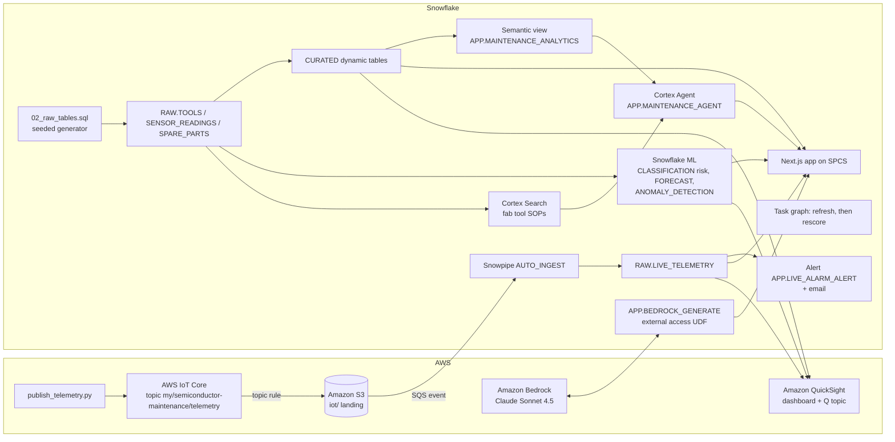

# APJ Predictive Maintenance - Malaysia Semiconductor Fab Tools

End-to-end predictive maintenance for **24 semiconductor fab tools across 5 fictional Malaysian sites** (Penang, Kulim, Melaka, Ipoh, Kuching) using Snowflake, optionally with AWS: from a live tool reading to a failure-risk score, an alarm email and an AI action memo for the fab operations team.

## Architecture

A predictive maintenance pipeline built on **Snowflake** (Dynamic Tables, Snowflake ML, Cortex Search, Cortex Agent, Cortex AI_COMPLETE, SPCS) and, in the full build, **AWS** (IoT Core, S3, Bedrock Claude, QuickSight + Amazon Q). Plasma etchers, CVD chambers, wire bonders and wafer probers report pump vibration and chamber temperature into `RAW.LIVE_TELEMETRY`. Dynamic tables curate 90 days of tool history. Snowflake ML scores the 7-day probability of an unscheduled down, forecasts fab-wide downtime and flags vibration anomalies. A Cortex Agent answers questions with SOP citations, and an LLM drafts the maintenance action memo.

Interactive diagrams (hover for object names): [Snowflake only](docs/architecture-snowflake.html) | [AWS + Snowflake](docs/architecture-aws.html). The app shows both diagrams on its Architecture & Data tab, the current build first. Regenerate both with `python3 docs/build_architecture.py aws` and `python3 docs/build_architecture.py snowflake`.



The Snowflake-only build drops the AWS subgraph: `APP.SIMULATE_TELEMETRY` writes to `RAW.LIVE_TELEMETRY`, and the app calls Cortex `AI_COMPLETE` instead of the Bedrock UDF.

## Snowflake Capabilities

| Capability | Implementation |
|-----------|---------------|
| Dynamic Tables | `CURATED.KPI_SUMMARY`, `PERFORMANCE_SUMMARY`, `DOWNTIME_CAUSES`, `TREND_ANALYSIS` from the RAW tables |
| Snowflake ML | CLASSIFICATION 7-day down risk per tool (`ML.FAILURE_RISK_SCORES`), 14-day fab-wide downtime FORECAST, pump vibration ANOMALY_DETECTION |
| Cortex Search | 15 synthetic SOPs (one per tool class and failure mode) in `SEARCH.MAINTENANCE_SOP_SEARCH` |
| Semantic View | `APP.MAINTENANCE_ANALYTICS` over tools, downtime, root causes and risk |
| Cortex Agent | `APP.MAINTENANCE_AGENT`: Cortex Analyst over the semantic view plus Cortex Search for SOP citations |
| Cortex AI | `AI_COMPLETE('claude-sonnet-4-5')` for grounded answers, and for the action memo in the Snowflake-only build |
| Alerts + Tasks | `APP.LIVE_ALARM_ALERT` logs ALARM readings and sends email; task graph `TASK_REFRESH_CURATED`, then `TASK_RESCORE_RISK` |
| Snowpark Container Services | Next.js app `APP.MY_SEMICONDUCTOR_MAINTENANCE_APP` with 6 tabs: Executive Cockpit, Predictive, PM Planning, Live IoT, Ask AI, Architecture & Data |
| Snowpipe | `RAW.LIVE_TELEMETRY_PIPE` AUTO_INGEST from S3 (AWS build only) |

## AWS Services

Used only in the AWS + Snowflake build.

| Service | Role in Demo |
|---------|-------------|
| AWS IoT Core | Receives simulated fab tool telemetry. A topic rule writes each message to S3 |
| Amazon S3 | Landing bucket. An event notification goes to the Snowpipe SQS queue |
| Amazon Bedrock | Claude Sonnet 4.5 writes the action memo, called from Snowflake through an external-access UDF |
| Amazon QuickSight | DIRECT_QUERY executive dashboard over Snowflake (downtime by fab tool, daily availability, down risk) |
| Amazon Q | Natural-language questions over the QuickSight topic `my-semiconductor-maintenance-topic` |
| AWS IAM / Secrets Manager | Least-privilege roles for S3, IoT and Bedrock; the QuickSight service credential |

## Personas

These personas and the fab operator are fictional.

| Persona | Role | Key Questions |
|---------|------|---------------|
| **Nurul Aisyah Rahman** | VP Fab Operations | "Which tools and sites drive unscheduled downtime?" "What is fab-wide tool availability?" |
| **Tan Wei Jie** | Equipment Engineer | "Which etchers and CVD chambers are high down risk this week, and which SOP applies?" |

## Data

All data is synthetic and seeded, so every rebuild reproduces it.

| Table | Rows | Description |
|-------|------|-------------|
| RAW.TOOLS | 24 | Fab tools across 5 sites and 4 tool classes (Plasma Etcher, CVD Chamber, Wire Bonder, Wafer Prober) |
| RAW.SENSOR_READINGS | 2,160 | Daily tool observations over 90 days: planned, operating and downtime hours, unscheduled downs, root cause, PM, wafer passes, pump vibration and chamber temperature |
| RAW.SPARE_PARTS | 24 | Required, on-hand and on-order critical spares per tool (RF match units, heater assemblies, capillary sets, probe cards) |
| SEARCH.MAINTENANCE_DOCS | 15 | Synthetic fab tool SOPs indexed for Cortex Search |
| RAW.LIVE_TELEMETRY | Grows during the demo | Live readings from IoT Core (AWS build) or `APP.SIMULATE_TELEMETRY` (Snowflake-only build) |
| ML.FAILURE_RISK_SCORES | 24 | 7-day down probability and risk band per tool |

## Build Instructions

### Prerequisites
- Snowflake account with ACCOUNTADMIN access, and Cortex AI enabled (AI_COMPLETE, Search, Agent).
- An X-Small warehouse with auto-suspend at or below 120 s, and an existing SPCS compute pool.
- Python 3.11+, `snowflake-connector-python`, Node.js 22+, Docker and the `snow` CLI.
- App image: create `APP.IMAGES` (`CREATE IMAGE REPOSITORY IF NOT EXISTS <DATABASE>.APP.IMAGES`), run `snow spcs image-registry login`, then build with `--platform linux/amd64` and push `my-semiconductor-maintenance-app:v1` (see the header of `snowflake/07_deploy_app.sql`).
- AWS build only: `boto3`, AWS credentials for the target account (us-west-2) with Bedrock access, and QuickSight Enterprise.

### SPCS App
```
<DATABASE>.APP.MY_SEMICONDUCTOR_MAINTENANCE_APP
```

### Tests
```bash
python -m pytest aws snowflake quicksight
```

The AWS tests validate the IoT Core `Publish` request against the botocore service model; nothing is sent to AWS.

For a local run, put `SNOWFLAKE_ACCOUNT`, `SNOWFLAKE_USER`, `SNOWFLAKE_DATABASE`, `SNOWFLAKE_WAREHOUSE`, `SNOWFLAKE_AUTHENTICATOR=PROGRAMMATIC_ACCESS_TOKEN`, `SNOWFLAKE_TOKEN` and `DEMO_PLATFORM` in the environment, then run `npm --prefix app run build && npm --prefix app start`.

## Build Modes

Both modes share the same core. They differ in three places, and the app's `DEMO_PLATFORM` setting (in its SPCS spec) switches the memo provider and the Live IoT tab copy. The Architecture tab always shows both diagrams, the current build first.

| Layer | Snowflake Only | Full AWS + Snowflake |
|---|---|---|
| Live telemetry | `CALL APP.SIMULATE_TELEMETRY(n)` inserts simulated readings into `RAW.LIVE_TELEMETRY`. This simulates a tool sensor feed; it is not Snowpipe Streaming | `aws/publish_telemetry.py` to AWS IoT Core, then S3, SQS and Snowpipe AUTO_INGEST |
| Action memo | Cortex `AI_COMPLETE('claude-sonnet-4-5')` | Amazon Bedrock Claude Sonnet 4.5 through `APP.BEDROCK_GENERATE` |
| BI and natural-language questions | The SPCS app is the dashboard; questions go to the Cortex Agent | Also a QuickSight dashboard and an Amazon Q topic |
| App setting | `DEMO_PLATFORM: snowflake` | `DEMO_PLATFORM: aws` |

### Snowflake Only

```bash
# 1. Core data and dynamic tables (guarded: new isolated database only)
python snowflake/run_core.py --database MALAYSIA_SEMICONDUCTOR_MAINTENANCE_SNOWFLAKE --warehouse <XS_WAREHOUSE> --connection <CONNECTION> --apply
# 2. Native telemetry, ML, search, semantic view, agent, alert and task graph
python snowflake/run_intelligence.py --database MALAYSIA_SEMICONDUCTOR_MAINTENANCE_SNOWFLAKE --platform snowflake --warehouse <XS_WAREHOUSE> --connection <CONNECTION> --alert-email you@example.com
# 3. App on SPCS with DEMO_PLATFORM=snowflake (create APP.IMAGES and push the image first)
python snowflake/run_intelligence.py --database MALAYSIA_SEMICONDUCTOR_MAINTENANCE_SNOWFLAKE --platform snowflake --warehouse <XS_WAREHOUSE> --connection <CONNECTION> --alert-email you@example.com --files 07_deploy_app.sql --compute-pool <COMPUTE_POOL>
```

During the demo:
- Run `CALL APP.SIMULATE_TELEMETRY(20)` to add live tool readings. For a continuous feed, run `ALTER TASK APP.TASK_SIMULATE_TELEMETRY RESUME`, and `SUSPEND` it afterwards.
- Run `EXECUTE ALERT APP.LIVE_ALARM_ALERT` to raise the alarm email.
- Run `EXECUTE TASK APP.TASK_REFRESH_CURATED` to refresh the curated tables and rescore risk.

Afterwards, drop the database or run `ALTER SERVICE APP.MY_SEMICONDUCTOR_MAINTENANCE_APP SUSPEND`.

### Full AWS + Snowflake

```bash
# 1. Core data and dynamic tables (guarded: new isolated database only)
python snowflake/run_core.py --database MALAYSIA_SEMICONDUCTOR_MAINTENANCE_AWS --warehouse <XS_WAREHOUSE> --connection <CONNECTION> --apply
# 2. AWS ingestion and Bedrock (dry run first, then --apply)
python aws/setup_aws.py --database MALAYSIA_SEMICONDUCTOR_MAINTENANCE_AWS --account <AWS_ACCOUNT_ID> --connection <CONNECTION> --apply
# 3. ML, search, semantic view, agent, alert and task graph
python snowflake/run_intelligence.py --database MALAYSIA_SEMICONDUCTOR_MAINTENANCE_AWS --platform aws --warehouse <XS_WAREHOUSE> --connection <CONNECTION> --alert-email you@example.com
# 4. App on SPCS with DEMO_PLATFORM=aws (create APP.IMAGES and push the image first)
python snowflake/run_intelligence.py --database MALAYSIA_SEMICONDUCTOR_MAINTENANCE_AWS --platform aws --warehouse <XS_WAREHOUSE> --connection <CONNECTION> --alert-email you@example.com --files 07_deploy_app.sql --compute-pool <COMPUTE_POOL>
# 5. QuickSight dashboard and Q topic (needs an existing Snowflake data source)
python quicksight/build_dashboards.py --database MALAYSIA_SEMICONDUCTOR_MAINTENANCE_AWS ... --apply --update --with-topic
```

QuickSight objects must be shared with the QuickSight user who signs in (`--principal-arn`); otherwise the console shows nothing.

During the demo:
- Run `python aws/publish_telemetry.py --count 20` to send live tool readings.
- Run `EXECUTE ALERT APP.LIVE_ALARM_ALERT` to raise the alarm email.
- Run `EXECUTE TASK APP.TASK_REFRESH_CURATED` to refresh the curated tables and rescore risk.

Afterwards, `python aws/teardown_aws.py ... --apply` removes the AWS resources and the account-level Bedrock external-access and S3 storage integrations. It leaves the email integration `MY_SEMICONDUCTOR_MAINTENANCE_EMAIL_INT`, which the Snowflake-only build also uses.

Renaming a demo database is not transparent:
- Recreate the SPCS service, and re-run `06_intelligence.sql`, because the agent spec names the database.
- Repoint `MY_SEMICONDUCTOR_MAINTENANCE_BEDROCK_EAI` at the renamed secret and network rule.
- Update the QuickSight data source and datasets with `build_dashboards.py --update`.

The service's ingress URL changes when the service is recreated.

## Business Impact

Industry research and Snowflake customer outcomes:
- **Predictive maintenance**, on average, increases productivity by 25%, reduces breakdowns by 70% and lowers maintenance costs by 25% -- [Deloitte Analytics Institute, Predictive Maintenance position paper](https://www.deloitte.com/content/dam/assets-zone2/de/de/docs/about/2024/Deloitte_Predictive-Maintenance_PositionPaper.pdf)
- **Equipment uptime** increases by 10 to 20%, while overall maintenance costs fall by 5 to 10% and maintenance planning time by 20 to 50% -- [same Deloitte paper](https://www.deloitte.com/content/dam/assets-zone2/de/de/docs/about/2024/Deloitte_Predictive-Maintenance_PositionPaper.pdf)
- **Scania** (Snowflake customer) streams data from 600,000 connected vehicles (150 million streaming messages) into Snowflake. It has "been able to reduce downtime for customers by recommending maintenance based on vehicle operation and workshop availability" -- [Snowflake Manufacturing Data Cloud press release](https://www.snowflake.com/en/news/press-releases/snowflake-launches-manufacturing-data-cloud-to-improve-supply-chain-performance-and-power-smart-manufacturing/)
- **Molex** (Snowflake customer, connector manufacturer) uses the Snowflake Manufacturing Data Cloud for "sharing data securely across the organization and with external partners and generating manufacturing shop-floor and business KPIs". This is a shop-floor data reference, not a predictive-maintenance outcome -- [same press release](https://www.snowflake.com/en/news/press-releases/snowflake-launches-manufacturing-data-cloud-to-improve-supply-chain-performance-and-power-smart-manufacturing/)

## Key Demo Numbers

These figures are synthetic and come from the seeded demo data. Forecast and anomaly figures can shift slightly with the build day.

- **24 fab tools**, 2,160 tool-days over 90 days, across 5 sites (Penang has 10 tools, Ipoh 5, Kulim 4, Melaka 4, Kuching 1)
- **Fab-wide tool availability 98.44%**; per-tool availability ranges from 93.42% (TOOL-0010, a Kulim plasma etcher) to 100%
- **201 unscheduled downs** across 12 root causes; RF generator faults (174.1 hours) and CVD heater drift (142.2 hours) cause the most downtime
- **Down-risk model** out-of-time holdout: precision 0.51, recall 0.52 at a 0.5 threshold, against a 0.29 base rate. The top tool is TOOL-0008, at 99.08%
- **14-day downtime forecast** with prediction intervals; **16 of 384** tool-days flagged as vibration anomalies
- **15 SOPs** indexed for Cortex Search and cited by ID in agent answers

## License

Apache 2.0 — See [LICENSE](LICENSE) for details.

This is a personal demo project and is not an official Snowflake offering. It comes with no support or warranty. Companies, sites and personas in the demo are fictional. Industry metrics cited are from publicly available third-party research and Snowflake customer stories; they represent reported outcomes and are not guarantees of results.
